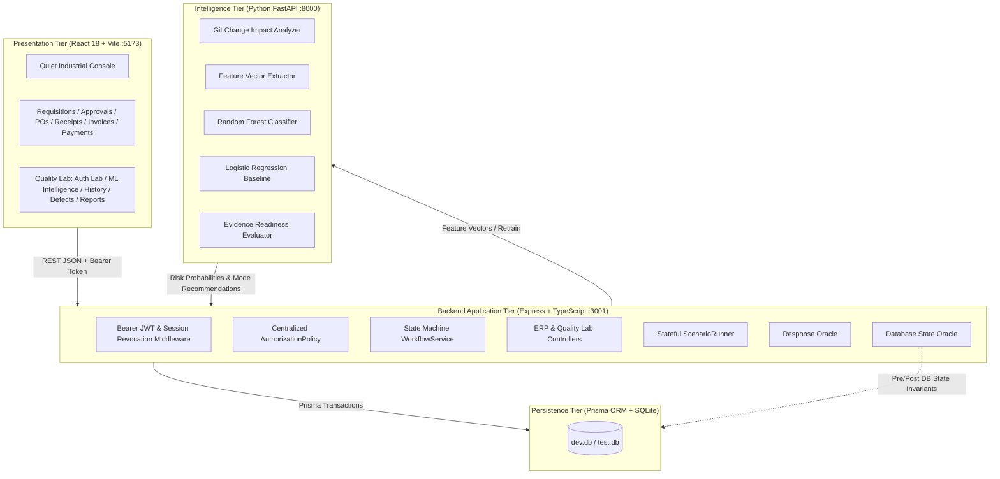
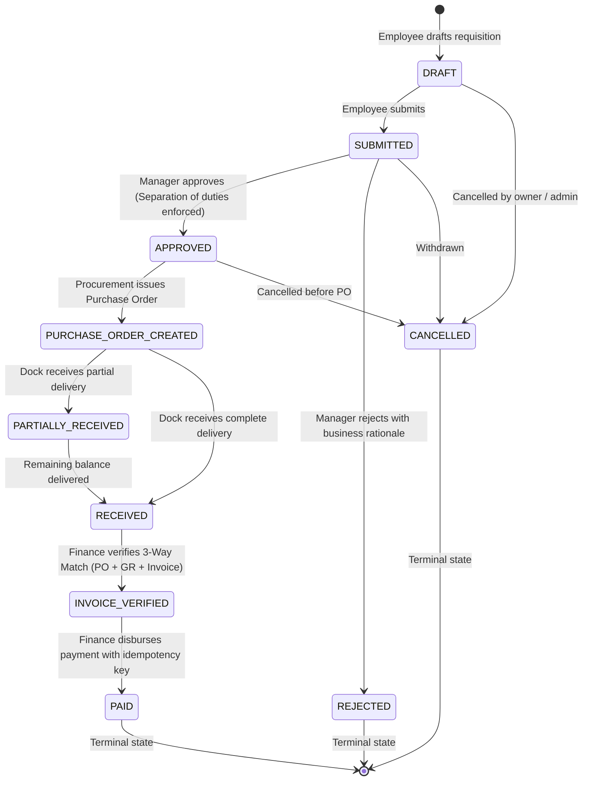
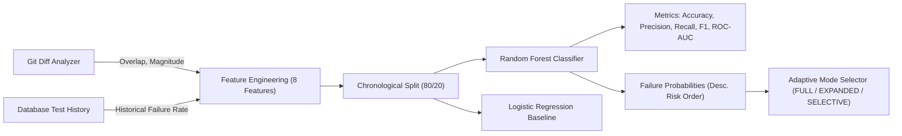

# ProcureFlow — Procurement ERP & Intelligent Software Quality Assurance Platform

[-397754?style=flat-square&logo=vitest&logoColor=white)](.)
[](.)
[](.)
[](.)
[](.)
[](.)
[](.)

**ProcureFlow** is an enterprise-grade procurement and purchase management ERP system integrated with an intelligent software quality assurance (QA) platform. The application manages the complete purchasing lifecycle of an organization — starting from employee purchase requisitions and ending with invoice verification and bank disbursement — while serving as the live System Under Test (SUT) for automated stateful authorization testing, predictive regression test selection, and confidence-aware adaptive test execution.

---

## 📑 Table of Contents

- [System Architecture](#-system-architecture)
- [Key Capabilities](#-key-capabilities)
  - [1. Procurement Operations ERP](#1-procurement-operations-erp)
  - [2. Stateful Authorization Testing (Module 1)](#2-stateful-authorization-testing-module-1)
  - [3. Predictive Regression Test Selection (Module 2)](#3-predictive-regression-test-selection-module-2)
  - [4. Confidence-Aware Adaptive Test Execution (Module 3)](#4-confidence-aware-adaptive-test-execution-module-3)
- [Visual Design System](#-visual-design-system)
- [Business Workflow Lifecycle](#-business-workflow-lifecycle)
- [Multi-Role Access Control Matrix](#-multi-role-access-control-matrix)
- [Stateful Authorization Scenarios (AUTH-001 – AUTH-015)](#-stateful-authorization-scenarios-auth-001--auth-015)
- [Machine Learning Architecture](#-machine-learning-architecture)
- [Demo Credentials](#-demo-credentials)
- [Quick Start & Installation](#-quick-start--installation)
- [Running Automated Tests](#-running-automated-tests)
- [Capstone Viva Walkthrough](#-capstone-viva-walkthrough)
- [Project Structure](#-project-structure)
- [Documentation Index](#-documentation-index)

---

## 🏛 System Architecture

ProcureFlow employs a clean, decoupled monorepo architecture with distinct responsibility separation across the UI console, backend transactional engine, and Python machine learning microservice:



---

## ⚡ Key Capabilities

### 1. Procurement Operations ERP
- **End-to-End Purchasing Lifecycle**: `DRAFT` → `SUBMITTED` → `APPROVED` → `PURCHASE_ORDER_CREATED` → `PARTIALLY_RECEIVED` / `RECEIVED` → `INVOICE_VERIFIED` → `PAID`.
- **Strict Separation of Duties**: Backend policies prevent employees from approving their own requisitions, and managers from approving self-generated requisitions.
- **Dock Goods Receiving**: Physical inspection logging comparing ordered vs. received vs. damaged item quantities.
- **3-Way Match Verification**: Mandatory reconciliation between commercial invoices, accepted dock goods receipts, and issued purchase orders prior to invoice verification.
- **Financial Disbursements with Idempotency**: Payment processing guarded by unique idempotency keys to reject duplicate disbursement requests (`HTTP 409 Conflict`).
- **Cryptographic Audit Trail**: Append-only system audit log recording every state mutation, user ID, and action metadata.

### 2. Stateful Authorization Testing (Module 1)
- **Multi-Dimensional Verification**: Evaluates authorization along 4 dimensions:
  1. *Role State* (Permissions assigned to `ADMIN`, `EMPLOYEE`, `MANAGER`, `PROCUREMENT`, `FINANCE`).
  2. *Session State* (Immediate invalidation upon logout; refresh-token reuse family revocation).
  3. *Resource Ownership* (Preventing cross-user IDOR access to draft requisitions).
  4. *Workflow State* (Rejecting illegal status jumps like `DRAFT` → `PAID`).
- **Dual Oracle Engine**:
  - **Response Oracle**: Evaluates HTTP status code, permission outcome, and error response schema.
  - **State Oracle**: Inspects SQLite database records before and after execution to assert zero unauthorized database mutations, row counts, and field invariants.
- **Fault Injection Simulation**: Toggleable runtime profiles (`standard` vs. `vulnerable`). Running against the vulnerable profile produces reproducible failures and automatically logs structured `Defect` records!

### 3. Predictive Regression Test Selection (Module 2)
- **Git Change Analysis**: Extracts modified files, additions, and deletions using `simple-git`.
- **Test-to-Source Mapping**: Connects code diffs to a declared catalog of 16 test suites.
- **Machine Learning Inference**: Python microservice trains **Random Forest** (primary) and **Logistic Regression** (baseline) classifiers on historical execution records using chronological validation splits to prevent information leakage.
- **Risk Ranking**: Returns test candidates ordered descending by failure probability with transparent selection rationales.

### 4. Confidence-Aware Adaptive Test Execution (Module 3)
- **Evidence Readiness Score**: Statistically derived metric (0.0 to 1.0) calculated from observed commits, total execution observations, and failure examples.
- **Dynamic Scope Routing**:
  - `FULL` (Readiness < 0.35 or cold-start): Runs 100% of test suites for safety.
  - `EXPANDED` (0.35 ≤ Readiness < 0.70): Runs affected tests + high-risk tests + critical security suites.
  - `SELECTIVE` (Readiness ≥ 0.70): Runs high-risk predictions and directly modified code paths (~65% runtime reduction).
  - `SHADOW`: Runs full suite in background while evaluating selective predictions to benchmark defect recall.

---

## 🎨 Visual Design System

Designed under the **Quiet Industrial Operations Console** aesthetic:
- **Palette Tokens**:
  - Canvas Background: `#F3F5F1`
  - Surface Surface: `#FFFFFF`
  - Primary Text: `#252D28`
  - Secondary Text: `#727D75`
  - Primary Accent: `#426B53`
  - Accent Background: `#EAF1EB`
  - Sidebar Background: `#202A24` (Dark forest charcoal)
  - Sidebar Text: `#DCE4DD`
  - Border: `#E0E5DF`
- **Semantic Status Tokens**:
  - Pending: `#B78337`
  - Success: `#397754`
  - Error: `#B64C43`
  - Information: `#506E86`
- **Typography**: **IBM Plex Sans** for interface text and **IBM Plex Mono** for identifiers, commit hashes, paths, and currency amounts.
- **Brand Mark**: Understated stacked-box procurement logo mark with `PROCUREFLOW / PROCUREMENT OPERATIONS`.

---

## 🔄 Business Workflow Lifecycle



---

## 🛡 Multi-Role Access Control Matrix

| Operation / Capability | ADMIN | EMPLOYEE | MANAGER | PROCUREMENT | FINANCE |
|---|:---:|:---:|:---:|:---:|:---:|
| **Login / Logout / Session Refresh** | ✅ | ✅ | ✅ | ✅ | ✅ |
| **Create Purchase Requisition** | ✅ | ✅ (own) | ✅ (own) | ✅ (own) | ❌ |
| **View Requisitions** | ✅ (all) | ✅ (own) | ✅ (all) | ✅ (all) | ✅ (all) |
| **Edit Draft Requisition** | ✅ | ✅ (if owner) | ✅ (if owner) | ❌ | ❌ |
| **Submit Draft Requisition** | ✅ | ✅ (if owner) | ✅ (if owner) | ❌ | ❌ |
| **Approve Requisition** | ✅ | ❌ | ✅ (subordinates) | ❌ | ❌ |
| **Approve Own Requisition (Self-Approval)** | ❌ (Blocked) | ❌ (Blocked) | ❌ (Blocked) | ❌ (Blocked) | ❌ (Blocked) |
| **Reject Requisition** | ✅ | ❌ | ✅ | ❌ | ❌ |
| **Manage Vendors / Suppliers** | ✅ | ❌ | ❌ | ✅ | ❌ |
| **Issue Purchase Order from Approved PR** | ✅ | ❌ | ❌ | ✅ | ❌ |
| **Issue PO from Unapproved PR** | ❌ (Blocked) | ❌ (Blocked) | ❌ (Blocked) | ❌ (Blocked) | ❌ (Blocked) |
| **Record Dock Goods Receipt & Inspection** | ✅ | ❌ | ❌ | ✅ | ❌ |
| **Record Vendor Commercial Invoice** | ✅ | ❌ | ❌ | ❌ | ✅ |
| **Verify Invoice (3-Way Match)** | ✅ | ❌ | ❌ | ❌ | ✅ |
| **Verify Invoice without Accepted GR** | ❌ (Blocked) | ❌ (Blocked) | ❌ (Blocked) | ❌ (Blocked) | ❌ (Blocked) |
| **Process Payment Disbursement** | ✅ | ❌ | ❌ | ❌ | ✅ |
| **Duplicate Payment Rejection** | ❌ (409 Conflict) | ❌ (409 Conflict) | ❌ (409 Conflict) | ❌ (409 Conflict) | ❌ (409 Conflict) |
| **User Administration & Audit Trail** | ✅ | ❌ | ❌ | ❌ | ❌ |
| **Quality Lab Scenario Execution** | ✅ | ❌ | ❌ | ❌ | ❌ |

---

## 🧪 Stateful Authorization Scenarios (AUTH-001 – AUTH-015)

All 15 scenarios run against live REST endpoints and validate both HTTP status codes and database state invariants:

| Scenario ID | Category | Scenario Title | Acting Role | Expected Status | State Oracle Check |
|---|---|---|---|:---:|---|
| **AUTH-001** | Role & Duties | Employee self-approval prevention | `EMPLOYEE` | 403 Forbidden | Requisition remains `SUBMITTED`; no Approval record written |
| **AUTH-002** | Resource Ownership | Cross-user resource isolation (editing peer draft) | `EMPLOYEE` | 403 Forbidden | Requisition `requestedById` remains unmodified |
| **AUTH-003** | Workflow Auth | Unauthorized PO creation from unapproved PR | `PROCUREMENT` | 400 Bad Request | Zero PurchaseOrder records created |
| **AUTH-004** | Financial Controls | Payment rejection for unapproved request | `FINANCE` | 400 Bad Request | Zero Payment records created |
| **AUTH-005** | 3-Way Match | Invoice verification rejection prior to dock receipt | `FINANCE` | 400 Bad Request | Invoice status remains `PENDING` |
| **AUTH-006** | Data Immutability | Modification of approved requests blocked | `EMPLOYEE` | 400 Bad Request | Requisition status and line items unchanged |
| **AUTH-007** | State Machine | Invalid workflow transition (DRAFT to INVOICE_VERIFIED) | `ADMIN` | 400 Bad Request | Requisition status remains `DRAFT` |
| **AUTH-008** | Session Lifecycle | Stale session access rejected after logout | `EMPLOYEE` | 401 Unauthorized | Session marked revoked in database |
| **AUTH-009** | Financial Controls | Duplicate payment idempotency enforcement | `FINANCE` | 409 Conflict | Exactly 1 Payment record exists |
| **AUTH-010** | Privilege Escalation| Unauthorized administrative access by non-admin | `EMPLOYEE` | 403 Forbidden | Zero users created; audit trail access denied |
| **AUTH-011** | Session Lifecycle | Refresh token reuse detection & revocation | `EMPLOYEE` | 401 Unauthorized | Refresh token family revoked |
| **AUTH-012** | Resource Ownership | IDOR on supplier modification | `EMPLOYEE` | 403 Forbidden | Supplier taxId remains unchanged |
| **AUTH-013** | Positive Workflow | Authorized employee creates PR | `EMPLOYEE` | 201 Created | Requisition created with status `DRAFT` |
| **AUTH-014** | Positive Workflow | Manager approves subordinate's submitted request | `MANAGER` | 200 OK | Status `APPROVED`; Approval record written |
| **AUTH-015** | Positive Workflow | Complete verified 3-Way Match invoice payment | `FINANCE` | 201 Created | Payment recorded; Invoice and PR status `PAID` |

---

## 🤖 Machine Learning Architecture



### Feature Vectors
1. `file_overlap_ratio`: Jaccard-style overlap between changed Git files and test's mapped source files.
2. `num_changed_files`: Total count of files modified in the commit.
3. `change_magnitude`: Log-normalized lines added and deleted: $\ln(1 + \text{additions} + \text{deletions})$.
4. `criticality_score`: Criticality weighting (`CRITICAL` = 3.0, `HIGH` = 2.0, `MEDIUM` = 1.0, `LOW` = 0.5).
5. `historical_failure_rate`: Empirical failure ratio observed in previous test runs.
6. `recent_failure_count`: Recent consecutive failure frequency.
7. `flakiness_score`: Execution outcome variance.
8. `avg_duration_sec`: Test execution runtime cost in seconds.

---

## 🔑 Demo Credentials

| Role | Name | Email | Password |
|---|---|---|---|
| **ADMIN** | System Administrator | `admin@procureflow.com` | `Admin@123` |
| **EMPLOYEE** | Alice Walker | `alice@procureflow.com` | `Employee@123` |
| **MANAGER** | Bob Roberts | `bob@procureflow.com` | `Manager@123` |
| **PROCUREMENT** | Carol Danvers | `carol@procureflow.com` | `Procure@123` |
| **FINANCE** | Dave Johnson | `dave@procureflow.com` | `Finance@123` |

*Tip: The web console features 1-click persona quick-fill buttons on the login page and a live Role Switcher dropdown in the top bar.*

---

## 🚀 Quick Start & Installation

### 1. Prerequisites
- Node.js (v20+ or v24+)
- Python (3.11+)
- Git

### 2. Install Dependencies
```powershell
npm install
```

### 3. Initialize & Seed Database
```powershell
# Synchronize Prisma schema with SQLite dev.db
npm run prisma:push

# Seed complete demonstration dataset & test catalog
npm run prisma:seed
```

### 4. Launch Services

Run in 3 separate terminal tabs from the project root:

**Terminal 1 — Machine Learning Microservice (Port 8000)**:
```powershell
$env:PYTHONPATH="apps/ml-service"; python apps/ml-service/run.py
```

**Terminal 2 — Backend API Server (Port 3001)**:
```powershell
npm run dev -w apps/api
```

**Terminal 3 — Frontend Web Console (Port 5173)**:
```powershell
npm run dev -w apps/web
```

Access the application in your browser at: **`http://localhost:5173`**

---

## 🧪 Running Automated Tests

```powershell
# Run all 34 automated unit, integration, and authorization tests
npm test

# Run unit tests only (Policy & Workflow State Machine)
npm run test:unit

# Run API integration tests only
npm run test:integration

# Run 15 stateful multi-role authorization scenarios
npm run test:auth
```

### Verified Test Results
```
Test Files  7 passed (7)
     Tests  34 passed (34)
  Duration  6.85s
```

---

## 🎓 Capstone Viva Walkthrough

Follow this 5-minute script to demonstrate the system during examination:

1. **Procurement Operations Workflow**:
   - Log in as **Alice Walker (Employee)** via the 1-click persona button.
   - Go to **Requisitions** → **Create Requisition** → Select items, enter business justification, and click **Submit for Manager Approval**. Show that Alice cannot self-approve.
   - Use the **Role Switcher** in the top bar to switch to **Bob Roberts (Manager)**.
   - Go to **Approval Queue** → Inspect the request → Click **Approve** with comments.
   - Switch to **Carol Danvers (Procurement)** → Go to **Purchase Orders** → Click **Issue Purchase Order** from the approved requisition → Go to **Goods Receipts** and record dock delivery.
   - Switch to **Dave Johnson (Finance)** → Go to **Invoices** → Verify the 3-Way Match (`PO + GR Matched`) → Go to **Payments** and click **Process Disbursement** with an idempotency key.

2. **Quality Lab — Stateful Authorization Testing**:
   - Navigate to **Quality Lab** → **Authorization Lab**.
   - With the profile set to **Standard (Secure)**, click **Run All 15 Scenarios**. Show 15/15 passing with Response & State Oracle assertions.
   - Switch the profile toggle to **Vulnerable (Fault Injection)** and run **AUTH-001**.
   - Show the security failure caught live, then navigate to **Defect Tracker** to demonstrate the automatically captured defect ticket!

3. **Quality Lab — Predictive Regression Selection**:
   - Navigate to **Regression ML**.
   - Show the live Git diff analysis (changed files, additions, deletions).
   - Show the **Evidence Readiness Score** breakdown and adaptive mode recommendation (`SELECTIVE` vs. `EXPANDED` vs. `FULL`).
   - Review the **Test Case Risk Predictions** table ranked descending by failure probability.
   - Click **Retrain ML Model** to demonstrate chronological cross-validation with Random Forest and Logistic Regression.

---

## 📁 Project Structure

```
procureflow/
│
├── apps/
│   ├── web/                     # React 18 + Vite + Tailwind Console
│   │   ├── src/
│   │   │   ├── components/      # Sidebar, TopBar, StatusBadge, PageHeader
│   │   │   ├── context/         # AuthContext
│   │   │   ├── pages/
│   │   │   │   ├── auth/        # Login
│   │   │   │   ├── erp/         # Dashboard, Requisitions, Approvals, POs, Receipts, Invoices, Pay, Audit, Users
│   │   │   │   └── qa/          # QAOverview, AuthorizationLab, RegressionML, History, Defects, Reports
│   │   │   └── services/        # Axios API client
│   │
│   ├── api/                     # Express + TypeScript Backend
│   │   ├── src/
│   │   │   ├── controllers/     # Auth, Requisitions, Approvals, POs, Receipts, Invoices, Payments, QA
│   │   │   ├── middleware/      # Bearer Auth, Session Revocation, Logger, Error Handler
│   │   │   ├── policies/        # Centralized AuthorizationPolicy
│   │   │   ├── workflows/       # Finite State Machine WorkflowService
│   │   │   ├── services/        # Business logic & data access
│   │   │   └── testing/         # ScenarioRunner, ResponseOracle, StateOracle, VulnerabilityProfiles
│   │
│   └── ml-service/              # Python FastAPI Machine Learning Microservice
│       ├── app/
│       │   ├── models/          # RandomForest & LogisticRegression Trainers & Predictors
│       │   ├── routers/         # /predict, /train, /status
│       │   ├── schemas/         # Pydantic data models
│       │   └── utils/           # Feature engineering & chronological splits
│       ├── stored_models/       # Serialized joblib model bundles
│       └── run.py               # Uvicorn entrypoint
│
├── packages/
│   ├── shared/                  # Common TypeScript interfaces & enums
│   └── test-catalog/            # Declared test cases & AUTH-001 - AUTH-015 scenario definitions
│
├── prisma/
│   ├── schema.prisma            # SQLite database schema
│   └── seed.ts                  # Demonstration database seeder
│
├── tests/
│   ├── unit/                    # AuthorizationPolicy and WorkflowService tests
│   ├── integration/             # Auth, PR, Approvals, Payments integration tests
│   └── authorization/           # Stateful Authorization Scenarios Runner
│
├── docs/                        # Complete 14-part academic capstone documentation
├── README.md
└── package.json
```

---

## 📚 Documentation Index

Detailed documentation is available in the [`docs/`](docs/) directory:

1. [`docs/PROJECT_OVERVIEW.md`](docs/PROJECT_OVERVIEW.md) — Capstone overview and goals.
2. [`docs/SYSTEM_ARCHITECTURE.md`](docs/SYSTEM_ARCHITECTURE.md) — High-level architecture and responsibilities.
3. [`docs/DATABASE_DESIGN.md`](docs/DATABASE_DESIGN.md) — Schema models, relationships, and constraints.
4. [`docs/API_DOCUMENTATION.md`](docs/API_DOCUMENTATION.md) — Complete REST API reference.
5. [`docs/ROLE_PERMISSION_MATRIX.md`](docs/ROLE_PERMISSION_MATRIX.md) — Role-based permission matrix.
6. [`docs/WORKFLOW_STATE_DIAGRAM.md`](docs/WORKFLOW_STATE_DIAGRAM.md) — State machine transition diagrams.
7. [`docs/TEST_PLAN.md`](docs/TEST_PLAN.md) — Comprehensive QA test plan.
8. [`docs/TEST_SCENARIOS.md`](docs/TEST_SCENARIOS.md) — Detailed specifications of AUTH-001 through AUTH-015.
9. [`docs/AUTHORIZATION_TESTING.md`](docs/AUTHORIZATION_TESTING.md) — Dual Oracle verification engine.
10. [`docs/REGRESSION_SELECTION_METHOD.md`](docs/REGRESSION_SELECTION_METHOD.md) — Feature engineering & selection algorithms.
11. [`docs/ML_TRAINING_AND_EVALUATION.md`](docs/ML_TRAINING_AND_EVALUATION.md) — Model training and evaluation methodology.
12. [`docs/QUALITY_METRICS.md`](docs/QUALITY_METRICS.md) — Performance, runtime reduction, and security metrics.
13. [`docs/DEMO_GUIDE.md`](docs/DEMO_GUIDE.md) — Step-by-step viva presentation script.
14. [`docs/KNOWN_LIMITATIONS.md`](docs/KNOWN_LIMITATIONS.md) — Real technical trade-offs and design boundaries.

---

## 📜 License

This project is created for academic capstone demonstration purposes.
