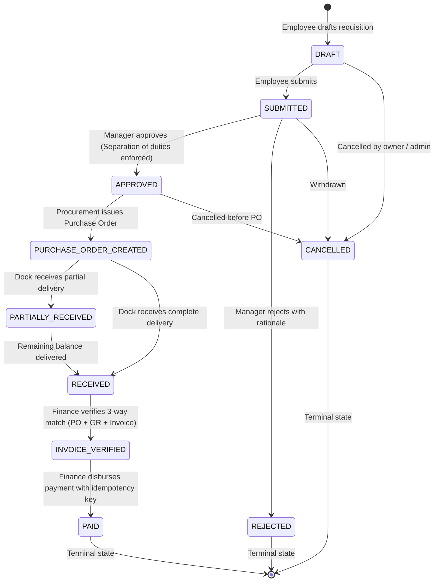

# ProcureFlow — Workflow State Diagram

## Explicit Allowed Transitions

| Starting State | Permitted Next States | Acting Role |
|---|---|---|
| `DRAFT` | `SUBMITTED`, `CANCELLED` | Employee (Owner), Admin |
| `SUBMITTED` | `APPROVED`, `REJECTED`, `CANCELLED` | Manager (Not Requester), Admin |
| `APPROVED` | `PURCHASE_ORDER_CREATED`, `CANCELLED` | Procurement, Admin |
| `PURCHASE_ORDER_CREATED` | `PARTIALLY_RECEIVED`, `RECEIVED` | Procurement, Admin |
| `PARTIALLY_RECEIVED` | `RECEIVED` | Procurement, Admin |
| `RECEIVED` | `INVOICE_VERIFIED` | Finance, Admin |
| `INVOICE_VERIFIED` | `PAID` | Finance, Admin |
| `PAID` | None (Terminal) | — |
| `REJECTED` | None (Terminal) | — |
| `CANCELLED` | None (Terminal) | — |

Direct status jumps (e.g., `DRAFT` straight to `PAID`, or `SUBMITTED` straight to `PURCHASE_ORDER_CREATED`) are rejected by `WorkflowService.assertTransition()` with HTTP 400 Bad Request.
